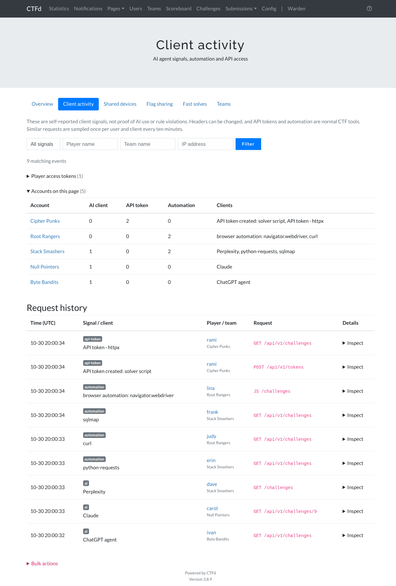

# Warden — anti-cheat and fair-play plugin for CTFd

[](https://github.com/0xZyyz/ctfd-warden/actions/workflows/tests.yml)

[](LICENSE)

Warden gives CTF organisers the tools to keep a competition fair: detection of AI agents, scripts,
shared accounts, shared flags and suspiciously fast solves, a per-challenge flag brute-force
lockout, and per-team challenge bans. It grew out of the anti-cheat tooling used at
**Securinets CTF Quals 2026**.

Copy one folder into CTFd, restart, done. No theme changes, no CTFd core patches.

## Features

Every feature can be switched on or off from **Admin → Warden**, without a restart.

| Feature | Default | What it does |
| --- | --- | --- |
| **Client activity** | on | Logs requests from self-identified AI agents (ChatGPT, Claude, Gemini, Perplexity, Cursor, browser-use, …), automation libraries and tools (`python-requests`, `curl`, Playwright, Selenium, sqlmap, …), CTFd API tokens, and in-page browser-automation marks such as `navigator.webdriver`. Player API tokens can be revoked from the same page. |
| **Shared devices** | on | Every browser gets a random device-ID cookie. Devices used by accounts on different teams are listed, a strong account-sharing signal that a VPN does not hide. |
| **Flag brute-force lockout** | on | A team (or user) that submits too many wrong flags on one challenge is locked out of that challenge for a while. Threshold, window and duration are configurable. |
| **Flag sharing** | on | For challenges you mark as having unique flags (an instancer, or a remote service that prints a per-session suffix accepted by a regex flag), reports the same flag submitted by two teams: who had it first, who reused it, and whether CTFd accepted it. A scan button checks everything submitted before, so you can audit a finished event too. |
| **Fast solves** | always available | Lists players who solved several challenges in a short time, by default 3 within 2 minutes, with the challenges and times. It reads CTFd's own solves, so it also works on a finished event. The numbers are configurable, and challenges meant to be instant, like a welcome flag, can be ignored. |
| **Challenge blocks** | always available | Bar one team or user from one challenge, e.g. after revoking a solve for flag sharing. The challenge disappears from their list and submissions are refused. |
| **Team privacy** | off | Hides team rosters, member countries and the user list from other players. Admins and the team itself still see everything. |
| **Regional brackets** | off | Places each team (or user, in users mode) in a regional bracket such as *MENA* / *Outside MENA* from members' nationalities. Bracket names and country list are configurable; manual admin choices are kept. |



> [!IMPORTANT]
> Client signals are **hints, not proof**. Headers can be forged, and scripts and API tokens are
> normal CTF tools. Use Warden's data to decide where to look, together with other evidence.

## Install

This repository **is** the plugin. Put it in CTFd's plugins folder and restart CTFd:

```sh
cd CTFd/plugins
git clone https://github.com/0xZyyz/ctfd-warden
```

That's it: Warden creates its tables on startup, then appears under **Admin → Warden**. Any folder
name works; just keep the same name once CTFd has started with it, because CTFd records the
plugin's database version under that name.

If you run the official Docker image, mount the clone into the plugins folder the same way:

```yaml
services:
  ctfd:
    image: ctfd/ctfd:3.8.9
    volumes:
      - ./ctfd-warden:/opt/CTFd/CTFd/plugins/ctfd-warden:ro
```

### Requirements

- **CTFd 3.8.x** with SQLite, MySQL/MariaDB or PostgreSQL. Tested on 3.8.0 and 3.8.9, and
  end-to-end on MariaDB with Redis and several workers. Older 3.x releases may work but are not
  tested.
- **Redis is recommended.** It is the default in CTFd's docker-compose. With Redis, lockout
  counters are atomic across workers. Without it, Warden logs a warning and the lockout still
  works, but counters are per worker.
- **Behind a reverse proxy** (nginx, Traefik, Cloudflare, a load balancer), configure CTFd's
  `REVERSE_PROXY` setting so CTFd sees the real client IP. Otherwise every player shows the
  proxy's IP on the Warden pages.

### Themes

Warden works with CTFd's default `core` theme and with custom themes. The automation-signal
script is injected through CTFd's plugin scripts, so your theme's `base.html` must render
`{{ Plugins.scripts }}`, as every standard theme does.

## Configuration

Everything is managed on **Admin → Warden**. Feature switches can also be forced from the
environment, which is useful for deployments managed as code. A feature forced this way is shown
as locked on the admin page.

| Environment variable | Feature |
| --- | --- |
| `WARDEN_CLIENT_ACTIVITY` | Client activity |
| `WARDEN_DEVICE_TRACKING` | Shared devices |
| `WARDEN_FLAG_LOCKOUT` | Flag brute-force lockout |
| `WARDEN_FLAG_SHARING` | Flag sharing |
| `WARDEN_TEAM_PRIVACY` | Team privacy |
| `WARDEN_REGIONAL_BRACKETS` | Regional brackets |

Use `1`/`0` (or `true`/`false`, `on`/`off`). Unset means the admin page decides.

### Flag sharing

Flag sharing can only be detected when teams get **different** flags. Two common ways:

- **Remote services** (`nc`, web): have the service add a random suffix to the flag for every
  connection, e.g. `flag{remote_<16 hex>}`, and give the challenge a **regex** flag such as
  `flag\{remote_[0-9a-f]{16}\}`. Logging the suffix on the server side also lets you trace
  any submitted flag back to one connection.
- **Instancers** that put a different flag in every team's instance.

Then tick the challenge on **Admin → Warden → Flag sharing**. Warden compares every submission on
watched challenges, accepted or not, with the earlier correct submissions of other teams.

### Regional brackets

When this is on, Warden creates two brackets for the current user mode and places every team in
the region bracket only when **all** its members have a nationality from the country list. A
missing nationality counts as outside. Players set their nationality in
**Settings → Profile → Country**.

CTFd still shows its bracket dropdown when a team is created; whatever players pick, Warden
places the team again right after. A bracket an admin sets by hand on a team is kept until it is
reset on the Warden page.

## Data Warden stores

Tell your players about it, for example in your rules. All of it can be deleted from the admin
pages.

| What | Where | Why |
| --- | --- | --- |
| For flagged requests only: time, user, team, IP, User-Agent, Referer, method, path | `warden_client_events` | Client activity (sampled once per user and client every 10 minutes) |
| Random device ID, user, last IP, User-Agent, first and last seen | `warden_device_sessions` + `warden_device` cookie (HttpOnly, 1 year) | Shared devices |
| Lockouts: time, team, user, challenge, IP, attempt count | `warden_lockout_events` | Flag lockout |
| Shared flags: challenge, flag, both teams and players, result, IP, time | `warden_flag_shares` | Flag sharing |
| Settings, challenge blocks, manual brackets, fast solve limits | CTFd's `config` table, keys `warden_*` | Configuration |

Ordinary browser requests are never logged. Warden sends nothing to third parties.

## Development

The `tests/`, `scripts/` and `.github/` folders are for development only; CTFd ignores them.
Tests run inside the official CTFd image, so only Docker is needed:

```sh
scripts/test-docker.sh                       # CTFd 3.8.9
CTFD_VERSION=3.8.0 scripts/test-docker.sh    # another CTFd release
scripts/test-docker.sh -k lockout            # extra pytest arguments
```

See [CONTRIBUTING.md](CONTRIBUTING.md) for the project layout and conventions, and
[SECURITY.md](SECURITY.md) to report a vulnerability.

## Credits

Built by [Mohamed Aziz Rahmouni (0xZyyz)](https://github.com/0xZyyz) for
[Securinets](https://github.com/securinets-insat) CTF Quals 2026, and released so other organisers
can use it.

## License

[Apache-2.0](LICENSE), the same license as CTFd.
